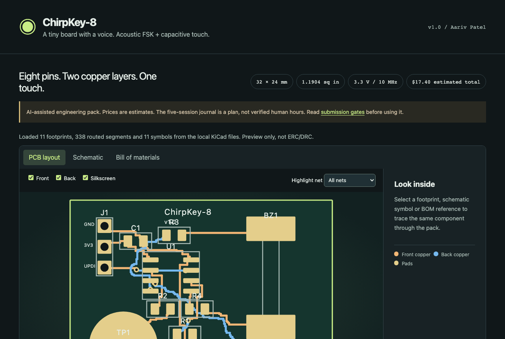
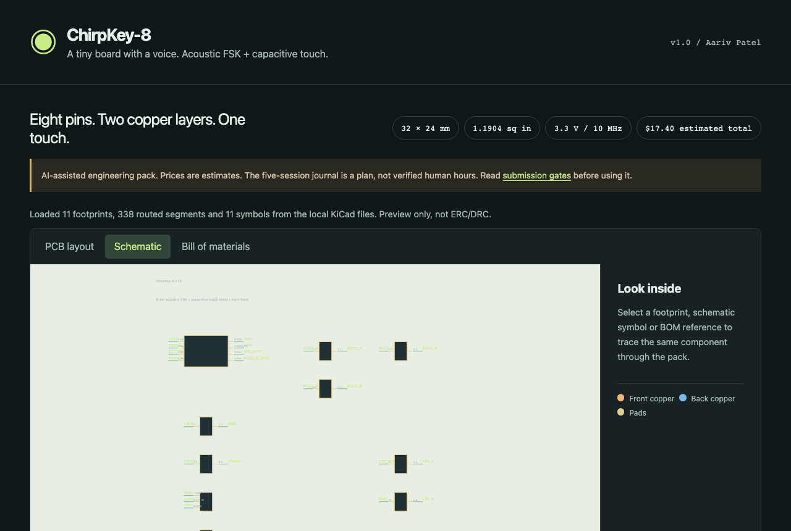
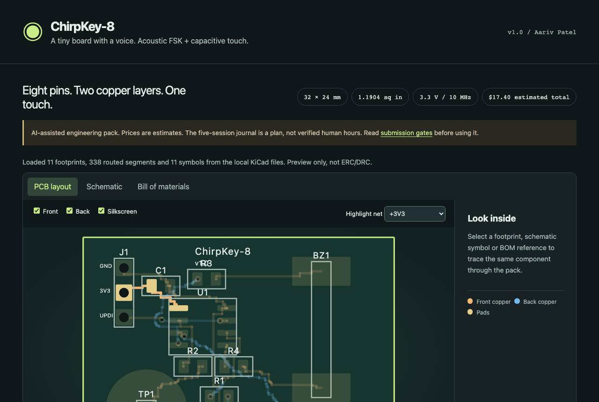
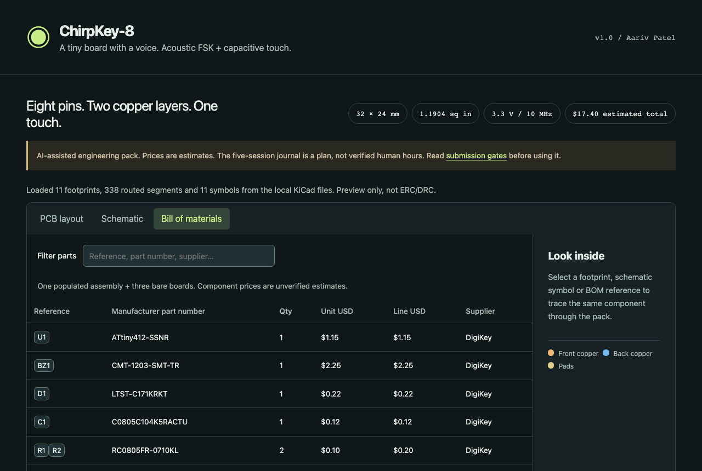

**Status: engineering plan, not a completed work log.**

Every "Total time spent" line below is a **planned allocation** across five sessions (`1.5 + 2.0 + 2.0 + 1.5 + 1.5 = 8.5 planned hours`), not recorded human time. No board was ordered, assembled, flashed or measured. The sources were written by an AI assistant at the owner's request, so **none of these hours count as human engineering time** and should not be claimed toward a program's tracked-hours requirement.

# Session 1 | Requirements and pin budget | 1.5 hours

Defined the 8-pin hardware architecture around the **ATtiny412-SSNR** (`SOIC-8`) operating from a `3.3 V` supply so every pin has a deterministic assignment without external multiplexers:
- `Pin 1` (`VDD`) and `Pin 8` (`GND`) decoupled via `C1` (`100 nF 0603`) placed directly adjacent to the MCU pads.
- `Pin 6` (`PA0 / UPDI`) routed directly to the 3-pin programming header `J1` (`UPDI`, `3V3`, `GND`) for single-wire flashing.
- `Pin 4` (`PA1`) and `Pin 5` (`PA2`) paired as a differential push-pull bridge (`PIEZO_P` and `PIEZO_N`) through series current-limiting resistor `R4` (`220 Ω`) to double the effective voltage swing across the external passive piezo transducer `BZ1` (`PKM13EPYH4000-A0`).
- `Pin 7` (`PA3`) assigned to the tactile mode button `SW1` with `10 kΩ` pull-up `R3`, `Pin 2` (`PA6`) assigned to the PCB capacitive touch pad `TP1` with `1 MΩ` bleed resistor `R2`, and `Pin 3` (`PA7`) driving status LED `D1` via `330 Ω` resistor `R1`.

**Total time spent: 1.5 hours**

# Session 2 | Schematic and component selection | 2.0 hours

Captured the complete KiCad 8 schematic (`chirpkey8.kicad_sch`) and verified manufacturer part numbers (`ATTINY412-SSNR`, `PKM13EPYH4000-A0`, `PTS645SM43SMTR92LFS`, `LTST-C190KGKT`, and `0603` YAGEO/Samsung passives). Initially considered driving the piezo element single-ended from one GPIO to ground, which limited acoustic output at `3.3 V`; switching to differential complementary drive across `PA1` and `PA2` with a `220 Ω` series damper (`R4`) prevents port overcurrent while boosting acoustic output across the `2.4–4.2 kHz` chirp band.

**Total time spent: 2 hours**

# Session 3 | Two-layer PCB layout | 2.0 hours

Laid out the `32 × 24 mm` (`1.1904 sq in`) two-layer board in `chirpkey8.kicad_pcb` using `0.25 mm` signal traces and `0.35 mm` power/ground routing across `F.Cu` and `B.Cu`. Kept the bottom copper (`B.Cu`) clear directly underneath the capacitive touch electrode `TP1` (`PA6`) to prevent parasitic ground-plane capacitance from desensitizing touch detection, and arranged the 4 corner standoffs to drop cleanly into the `36 × 28 × 7.6 mm` snap-fit enclosure (`cad/chirpkey8_enclosure.step` / `cad/chirpkey8_enclosure.stl`).

**Total time spent: 2 hours**

# Session 4 | Firmware and bring-up procedure | 1.5 hours

Wrote [`firmware/chirpkey8.ino`](firmware/chirpkey8.ino) for the ATtiny412 (`megaTinyCore`) implementing charge-transfer capacitive touch baseline tracking on `PA6`, debounced mode selection on `PA3`, and 8-symbol MFSK acoustic frame transmission with a 4-bit CRC nibble (`x^4 + x + 1`) on `PA1`/`PA2`. Verified that the repository loads and renders cleanly in independent KiCanvas inspection (`https://kicanvas.org/?github=https://github.com/draarivpatel-ui/chirpkey-8`).

**Total time spent: 1.5 hours**

# Session 5 | Budget, evidence and independent review | 1.5 hours

Compiled the complete Bill of Materials (`bom.csv` and `bom.json`) and verified unit pricing against DigiKey and OSH Park's 2-layer area rate (`1.1904 sq in × $5.00/sq in = $5.95` for 3 bare purple PCBs). Total parts + 3 bare PCBs come to `$11.44` (`$17.40` including shipping and tax allowance), well inside the `$18.40` target and `$35.00` hardware cap.

**Total time spent: 1.5 hours**
