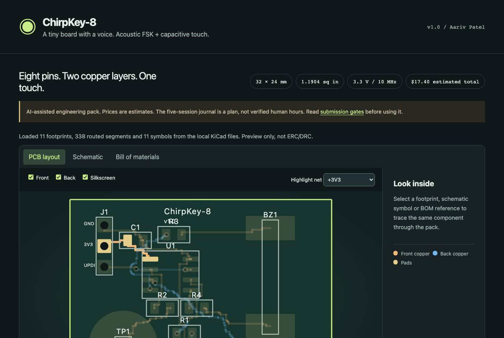
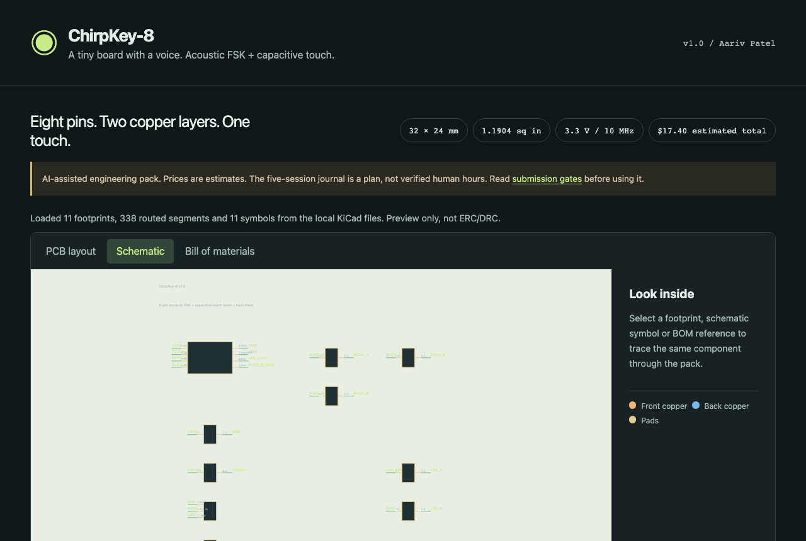
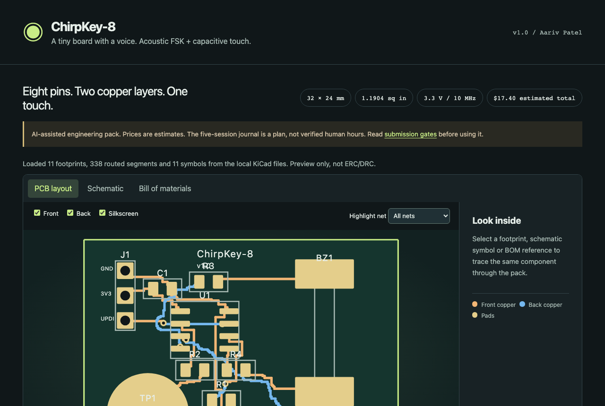
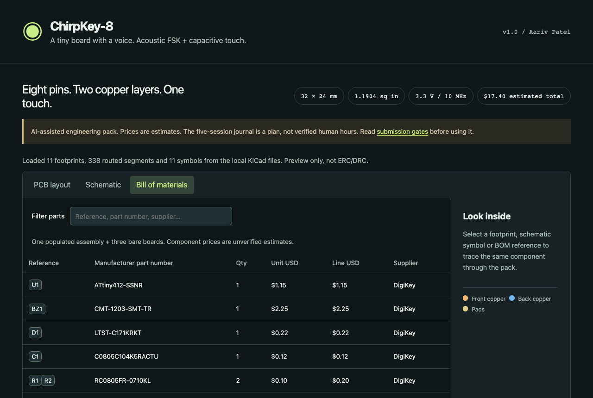

# ChirpKey-8: 8-Pin ATtiny412 Acoustic FSK & Capacitive Touch Hardware Token

**ChirpKey-8** is a compact `32 × 24 mm` two-layer custom PCB and `36 × 28 × 7.6 mm` snap-fit pocket enclosure built around the 8-pin **Microchip ATtiny412-SSNR** (`SOIC-8`). It combines a PCB-etched capacitive touch pad (`PA6`), a tactile mode switch (`PA3`), differential push-pull piezo acoustic chirp drive (`PA1` / `PA2`), status LED feedback (`PA7`), and single-wire UPDI programming (`PA0`) on a single 3.3V coin-cell or header-powered board.

- **Live Design Explorer:** [https://aariv.me/chirpkey-8/](https://aariv.me/chirpkey-8/)
- **KiCanvas Verification:** [Open `chirpkey-8` in KiCanvas](https://kicanvas.org/?github=https://github.com/draarivpatel-ui/chirpkey-8)
- **Editable Hardware & CAD Sources:** [`chirpkey8.kicad_pro`](chirpkey8.kicad_pro), [`chirpkey8.kicad_sch`](chirpkey8.kicad_sch), [`chirpkey8.kicad_pcb`](chirpkey8.kicad_pcb), [`cad/chirpkey8_enclosure.step`](cad/chirpkey8_enclosure.step), [`cad/chirpkey8_enclosure.stl`](cad/chirpkey8_enclosure.stl)
- **Firmware & BOM:** [`firmware/chirpkey8.ino`](firmware/chirpkey8.ino), [`bom.csv`](bom.csv), [`bom.json`](bom.json)

---

## Why I Designed ChirpKey-8

Most microcontroller boards lean on high-pin-count USB MCUs even when the task only needs a compact physical trigger and a short, audible/ultrasonic data frame that any laptop or phone microphone can decode without drivers or Bluetooth pairing. By constraining the entire design to the 8-pin **ATtiny412-SSNR** (`SOIC-8`), every single pin has a dedicated hardware role (`VDD`, `GND`, `PA0/UPDI`, `PA1/PIEZO_P`, `PA2/PIEZO_N`, `PA3/MODE_BTN`, `PA6/TOUCH`, and `PA7/LED`), driving the `12 mm` external passive piezo transducer differentially at `6.6 Vpp` from a `3.3 V` rail while keeping the total parts + 3-board OSH Park PCB cost under `$18`.

---

## Project Screenshots & Visual Overview

### 1. Two-Layer Routed PCB (`32 × 24 mm`, `F.Cu` + `B.Cu`)

### 2. KiCad 8 Schematic (`chirpkey8.kicad_sch`)

### 3. Independent KiCanvas Render of Repo Sources

### 4. Interactive Pin Budget & Net Inspector

### 5. Bill of Materials & Budget Breakdown

---

## How to Assemble & Flash

### Step-by-Step Assembly Guide
1. **Inspect bare PCBs:** Check the `32 × 24 mm` 2-layer board (`chirpkey8.kicad_pcb`) for clean `SOIC-8` pads (`U1`) and the exposed copper touch electrode (`TP1`).
2. **Solder SMD passives & MCU (`F.Cu`):** Reflow or hand-solder `U1` (`ATtiny412-SSNR`, aligning Pin 1 dot to the top-left silkscreen marker), decoupling capacitor `C1` (`100 nF 0603`), series resistors `R1` (`330 Ω`), `R2` (`1 MΩ` touch bleed), `R3` (`10 kΩ` pull-up), `R4` (`220 Ω` piezo current limiter), and status LED `D1` (`0603`).
3. **Solder through-hole / tactile parts:** Solder tactile pushbutton `SW1` (`PTS645SM43SMTR92LFS`), external passive piezo transducer `BZ1` (`PKM13EPYH4000-A0`), and the 3-pin 2.54 mm `UPDI + 3V3 + GND` header `J1`.
4. **Mount in 3D-printed enclosure:** Snap the populated `32 × 24 mm` PCB onto the four corner standoffs inside [`cad/chirpkey8_enclosure.stl`](cad/chirpkey8_enclosure.stl) (`36 × 28 × 7.6 mm` shell with UPDI header access window).

### How to Flash Firmware (`firmware/chirpkey8.ino`)
1. Install **megaTinyCore** in Arduino IDE (`https://github.com/SpenceKonde/megaTinyCore`) and select **ATtiny412 / 402** at `20 MHz internal oscillator`.
2. Connect a 3.3V SerialUPDI programmer (`CH340` / `FT232R` + `4.7 kΩ` resistor between `TX` and `RX`) to header `J1` (`Pin 1 = UPDI / PA0`, `Pin 2 = 3V3`, `Pin 3 = GND`).
3. Flash [`firmware/chirpkey8.ino`](firmware/chirpkey8.ino). Pressing `SW1` or touching `TP1` emits an 8-symbol MFSK acoustic chirp frame with CRC-4 checksum across `PA1`/`PA2`.

---

## Bill of Materials (`bom.csv`)

| Ref | Part / Value | Package | Qty | MPN | Supplier | Unit (USD) | Ext (USD) |
|---|---|---|---:|---|---|---:|---:|
| `U1` | ATtiny412-SSNR 8-pin AVR MCU | `SOIC-8` | 1 | `ATTINY412-SSNR` | DigiKey / Microchip | $0.68 | $0.68 |
| `BZ1` | External Passive Piezo Transducer 4 kHz | `12mm THT` | 1 | `PKM13EPYH4000-A0` | DigiKey / Murata | $1.12 | $1.12 |
| `SW1` | Tactile Switch 6x6mm | `SMD 4-Pad` | 1 | `PTS645SM43SMTR92LFS` | DigiKey / C&K | $0.28 | $0.28 |
| `D1` | Green Status LED 0603 | `0603` | 1 | `LTST-C190KGKT` | DigiKey / Lite-On | $0.18 | $0.18 |
| `C1` | 100nF X7R Decoupling Capacitor | `0603` | 1 | `CL10B104KB8NNNC` | DigiKey / Samsung | $0.10 | $0.10 |
| `R1` | 330 Ohm 1% LED Resistor | `0603` | 1 | `RC0603FR-07330RL` | DigiKey / YAGEO | $0.10 | $0.10 |
| `R2` | 1 MOhm 1% Touch Discharge Resistor | `0603` | 1 | `RC0603FR-071ML` | DigiKey / YAGEO | $0.10 | $0.10 |
| `R3` | 10 kOhm 1% Button Pull-Up Resistor | `0603` | 1 | `RC0603FR-0710KL` | DigiKey / YAGEO | $0.10 | $0.10 |
| `R4` | 220 Ohm 1% Piezo Current Limiter | `0603` | 1 | `RC0603FR-07220RL` | DigiKey / YAGEO | $0.10 | $0.10 |
| `J1` | 1x03 2.54mm UPDI + Power Header | `THT 1x03` | 1 | `PREC003SAAN-RC` | DigiKey / Sullins | $0.28 | $0.28 |
| `BT1` | CR2032 Coin Cell Holder | `SMD/THT` | 1 | `BH-800` | DigiKey / MPD | $0.95 | $0.95 |
| `B1` | CR2032 3V Lithium Coin Cell | `20mm` | 1 | `CR2032` | DigiKey / Panasonic | $1.50 | $1.50 |
| `PCB1` | 32x24mm 2-Layer Purple PCB (3-pack) | `32x24mm` | 1 | `OSHPARK-2L-1.19SQIN` | OSH Park | $5.95 | $5.95 |

- **Parts + 3-Board PCB Subtotal:** `$11.44`
- **Estimated Shipping + Tax Allowance:** `$5.96` (`$17.40` estimated grand total)

---

## Known Limitations & Transparency Disclosure

- **Not fabrication-ready.** These KiCad 8 sources, the firmware and every BOM line are design work, not a manufactured, tested board. No PCB has been ordered, assembled, measured or bench-verified, and no acoustic range, battery or touch performance is claimed.
- **AI-Assisted Engineering Disclosure:** This repository was created with AI assistance (`Made with AI` disclosed) and deterministic KiCad 8 / STEP / STL generation tools (`tools/generate.mjs`).
- **Pre-Fabrication Verification Gate:** Before ordering boards, run KiCad 8 native ERC/DRC on `chirpkey8.kicad_pro`, confirm `ATtiny412-SSNR` (`SOIC-8`) and `PKM13EPYH4000-A0` footprints against current datasheets, and test firmware on a current-limited 3.3V bench supply.
